<!-- ════════════════════════════════════════════════════════════════════════════
     RYSHAR NUÑEZ · README.md — Edición Élite
     Paleta cromática de marca (estricta e innegociable):
       • Rojo firma (acción / posicionamiento / CTA)   →  dc2626
       • Negro profundo (soporte / label / contorno)   →  171717  ·  1a1a1a  ·  262626
       • Grises neutros (texto / secundario)           →  e5e5e5  ·  a3a3a3  ·  737373
       • Fondo base (telemetría / tarjetas)            →  0a0a0a
     ════════════════════════════════════════════════════════════════════════════ -->

  

 

<h1 align="center">RYSHAR NUÑEZ</h1>

  <code>Arquitectura Resiliente · Ciberseguridad Ofensiva · Automatización Crítica</code>

 

  
  
  
  

 

  

 

---

## ⌬  Doctrina Operativa

> **Construyo sistemas que tu negocio no puede permitirse que fallen.**

No ensamblo componentes: diseño **operaciones resilientes** pensadas para escalar. Combino desarrollo full-stack y ciberseguridad ofensiva para automatizar procesos críticos — IA, CRMs y bases de datos *legacy* integrados sin abrir brechas. Seguridad desde la primera línea de código, no como parche.

Hablo el idioma de los hackers **y** el de las juntas directivas. Traduzco riesgo técnico en decisiones ejecutivas y decisiones ejecutivas en arquitectura segura. Trabajo con operaciones donde un minuto caído cuesta miles de euros: tolerancia cero al fallo, pocos proyectos a la vez, solo los de alto impacto.

Si tu operación depende de procesos que no pueden parar, no buscas otro desarrollador. **Buscas a alguien que elimine el riesgo desde el diseño.**

---

## ⚙  Arsenal Técnico

**Interfaces & Frontend**

**Backend & Lenguajes**

**Cloud · DevOps · Infraestructura**

**Datos · IA · Automatización**

 

**Ciberseguridad Ofensiva & Herramientas**

  

**Orquestación & Integraciones**

 

---

## ▣  Operaciones Desplegadas — Casos de Estudio

No son "proyectos". Son **infraestructuras de misión crítica** entregadas end-to-end, con métricas de negocio verificables.

 

<table>
  <tr>
    <td width="50%" valign="top">
      <h3 align="center">⬡ 01 · Pipeline de Leads con IA</h3>
      
<em>Scoring y nutrición automatizada de leads en tiempo real.</em>

      

        
          
        
        
        
      

    </td>
    <td width="50%" valign="top">
      <h3 align="center">⬡ 02 · ERP ↔ eCommerce</h3>
      
<em>Sincronización de inventario en tiempo real, cero overselling.</em>

      

        
          
        
        
        
      

    </td>
  </tr>
  <tr>
    <td width="50%" valign="top">
      <h3 align="center">⬡ 03 · Alertas de Ciberseguridad</h3>
      
<em>Pipeline automatizado de detección de amenazas, MTTD &lt; 2 min.</em>

      

        
        
          
        
        
        
      

    </td>
    <td width="50%" valign="top">
      <h3 align="center">⬡ 04 · ETL Inteligente para BBDD Legada</h3>
      
<em>Migración y normalización de 500k registros con LLM.</em>

      

        
          
        
        
        
      

    </td>
  </tr>
  <tr>
    <td width="50%" valign="top">
      <h3 align="center">⬡ 05 · Asistente IA de Soporte</h3>
      
<em>Integración WhatsApp API + OpenAI + CRM, latencia &lt; 50ms.</em>

      

        
        
          
        
        
        
      

    </td>
    <td width="50%" valign="top">
      <h3 align="center">⬡ 06 · Dashboard de KPIs en Tiempo Real</h3>
      
<em>Monitoreo de telemetría y métricas operativas en vivo.</em>

      

        
          
        
        
        
      

    </td>
  </tr>
</table>

 

---

## ◇  Trayectoria & Flujo de Valor

| Período | Frente de Operaciones | Resultado Clave |
|:---:|:---|:---|
| **2022 — Actualidad** | Automatización & IA · Freelance / Independiente | +30 flujos en producción · **−25% tiempo operativo** · integración end-to-end de IA, CRMs y datos legacy |
| **2019 — 2022** | Frontend Engineering · Freelance & Académico | +20 plataformas web responsivas · componentes reutilizables · UX/UI de precisión |
| **2023 — 2026** | Ingeniería en Ciberseguridad · UCI (Cuba) | IA · Seguridad en el desarrollo · Diseño de Sistemas Web · Estructuras de Datos y Algoritmos |

 

> **Foco permanente:** convertir riesgo técnico en decisión ejecutiva y decisión ejecutiva en arquitectura segura.

 

---

## ▦  Telemetría de GitHub — Actividad Operativa

  

 

---

## ◈  Modelo de Compromiso

 

> Solo acepto **3 nuevos clientes por mes** para garantizar máxima calidad, foco y tolerancia cero al fallo en cada entrega.

 

  

 

&nbsp;

&nbsp;

&nbsp;

 

  <code>Diseñado para resistir.</code>

 

---

<!-- ════════════════════════════════════════════════════════════════════════════
     INSTRUCCIONES DE PERSONALIZACIÓN
     ════════════════════════════════════════════════════════════════════════════ -->

## 🛠  Instrucciones de Personalización

1. **Telemetría de GitHub:** reemplaza todas las apariciones de `RysharOmar` en las URLs de `github-readme-stats` y `streak-stats.demolab.com` por tu usuario real si difiere.
2. **Contacto:** actualiza el handle de Telegram (`https://t.me/`) y el dominio de email (`contacto@ryshar.dev`) si cambian; el sitio (`rysharpereznunez.vercel.app`) puede sustituirse por tu dominio final.
3. **Assets visuales:** conserva `terminal.svg`, `1box.svg` y `2box.svg` en la raíz del repo del perfil (`<usuario>.github.io`), o reemplázalos por banners propios manteniendo la paleta `#dc2626 · #171717 · #0a0a0a` para preservar la coherencia de marca.
