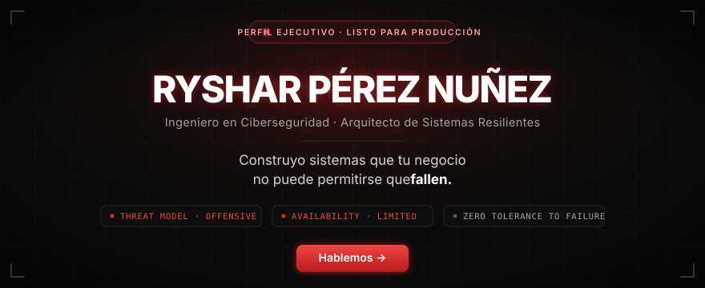

  

  

# RYSHAR PÉREZ NUÑEZ

**Ingeniero en Ciberseguridad · Arquitecto de Sistemas Resilientes**

 

> *"Construyo sistemas que tu negocio no puede permitirse que fallen."*

 

Ciberseguridad ofensiva y desarrollo full-stack, fusionados en infraestructuras que no solo funcionan — **resisten**. Hablo el idioma de los hackers y el de las juntas directivas. Traduzco riesgo técnico en decisiones ejecutivas y decisiones ejecutivas en arquitectura segura.

 

---

## ⚙️ CORE TECH STACK

<table>
<tr>
<td valign="top" width="50%">

### Frontend

</td>
<td valign="top" width="50%">

### Backend & IA

</td>
</tr>
<tr>
<td valign="top" width="50%">

### Cloud & DevOps

</td>
<td valign="top" width="50%">

### Databases & APIs

</td>
</tr>
</table>

### Ciberseguridad Ofensiva

---

## ⚡ CASOS DE ÉXITO

<table>
<tr>
<td valign="top" width="33%">

### 01 · Pipeline IA de Leads
**Scoring y nutrición automatizada de leads a escala.**

`Salesforce` `GPT-4` `Python`

 

> ▲ **+35% conversión**
> ◆ **0 overselling** en Black Friday

</td>
<td valign="top" width="33%">

### 02 · Alertas de Ciberseguridad
**Detección y normalización de amenazas en tiempo real.**

`Splunk` `Webhook` `Slack`

 

> ◆ **MTTD < 2 min**
> ▲ **99.8%** precisión de normalización

</td>
<td valign="top" width="33%">

### 03 · Asistente IA de Soporte
**Atención automatizada L1 con IA conversacional.**

`OpenAI` `WhatsApp API` `CRM`

 

> ▼ **−60% tickets L1**
> ◆ **Latencia < 50ms**

</td>
</tr>
</table>

---

## 📊 MÉTRICAS

  

---

## CONTACTO

 

*Solo acepto **3 nuevos clientes por mes** para garantizar tolerancia cero al fallo.*

  

**`Diseñado para resistir.`**

